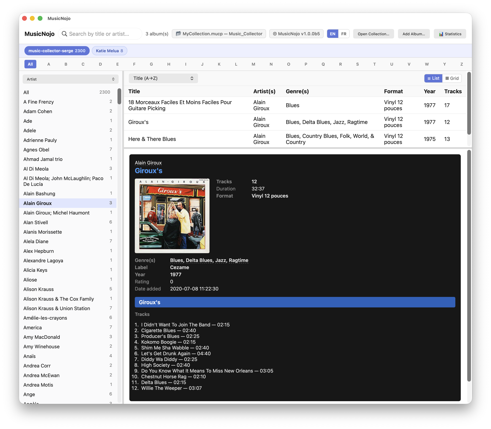
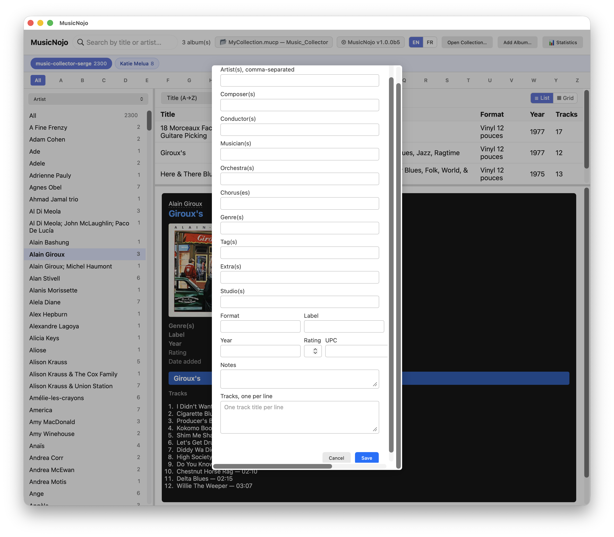

# MusicNojo

> 🇬🇧 [Read in English](README.md)

## Pourquoi ce projet

Gestionnaire de collection de musique. Music Collector pour Mac est
une application Intel qui dépend de Rosetta 2. Apple a annoncé la fin
programmée de Rosetta 2 (support complet jusqu'à macOS 27, largement
retiré à partir de macOS 28, ~automne 2027) — Music Collector a donc
une espérance de vie limitée sur un Mac à jour. MusicNojo importe la
base de données d'une collection [Music Collector](https://www.collectorz.com/music)
(Collectorz) dans ses propres outils, et permet de la parcourir,
l'exporter et la modifier sans être limité à ce que l'application de
l'éditeur propose elle-même — lisant et écrivant une copie de la
collection existante avec ses propres outils indépendants (export,
consultation, ajout, modification, suppression, pochettes), pour
qu'elle continue de fonctionner, et de grandir, sans dépendre de Music
Collector pour l'un ou pour l'autre, le jour où il ne tournera plus.

MusicNojo est un projet frère de [BookNojo](https://github.com/sergiodadi/BookNojo)
(la même approche et le même problème de fond avec Rosetta 2, appliqués
à Book Collector au lieu de Music Collector).

> Projet en développement actif, disponible publiquement depuis le
> 17/11/2026.

## Ce qu'il fait aujourd'hui

- **Application macOS** (icône, fenêtre, menus natifs) pour consulter,
  ajouter, modifier et supprimer des albums d'une collection — avec
  sauvegarde automatique avant toute écriture, et refus pur et simple
  d'écrire sur ce qui ressemble à la vraie collection.
- Regroupement par artiste/genre/format/pays/label, avec une barre
  A→Z ; recherche ; tri (menu déroulant ou clic sur colonne) ; vue
  liste/grille ; pagination.
- Plusieurs sous-collections dans un même fichier — des onglets
  permettent de basculer entre elles.
- Panneau de statistiques (genres, formats, pays, labels, décennies,
  année d'ajout), avec les compteurs "sans pochette"/"sans artiste"
  cliquables pour voir de quels albums il s'agit — et la liste "sans
  pochette" permet aussi d'ajouter la pochette manquante en un clic.
- Interface bilingue français/anglais.
- Export en ligne de commande vers **CSV**, **JSON**, et une page
  **HTML** autonome.

➡️ Guide complet d'utilisation de l'application : [`MANUAL.fr.md`](MANUAL.fr.md).
Des outils en ligne de commande existent aussi (export CSV/JSON/HTML,
scripts) — facultatifs, non nécessaires pour un usage courant : voir
[`CLI.fr.md`](CLI.fr.md).

## Installation

Télécharger le `.dmg` depuis la [dernière release](https://github.com/sergiodadi/MusicNojo/releases/latest),
l'ouvrir, et glisser MusicNojo.app dans Applications.

> ⚠️ **« MusicNojo est endommagé et ne peut pas être ouvert » ?**
> MusicNojo n'est pas signé avec un certificat développeur Apple, donc
> le Gatekeeper de macOS le met en quarantaine et affiche ce message
> trompeur — l'app n'est pas réellement endommagée. Corriger en
> lançant ceci une fois dans le Terminal, puis ouvrir l'app
> normalement :
> ```bash
> xattr -cr /Applications/MusicNojo.app
> ```
> Si ça ne suffit pas, clic droit (ou Ctrl-clic) sur l'app et choisir
> **Ouvrir** plutôt que double-cliquer.

Pour compiler depuis les sources plutôt que d'utiliser le `.dmg`, voir
[`BUILD.fr.md`](BUILD.fr.md).

> Testé uniquement sur **macOS Tahoe (26)** — non vérifié sur d'autres
> versions de macOS.

## Copie d'écran




## Historique des versions

Voir [`CHANGELOG.fr.md`](CHANGELOG.fr.md).

## Licence

[MIT](LICENSE).

---

Ces paquets ont été construits, testés et publiés avec l'aide de Claude, l'assistant IA d'Anthropic.

Music Collector et Collectorz/CLZ sont des marques déposées de leurs propriétaires respectifs. MusicNojo est un projet indépendant, non affilié à ces sociétés.
